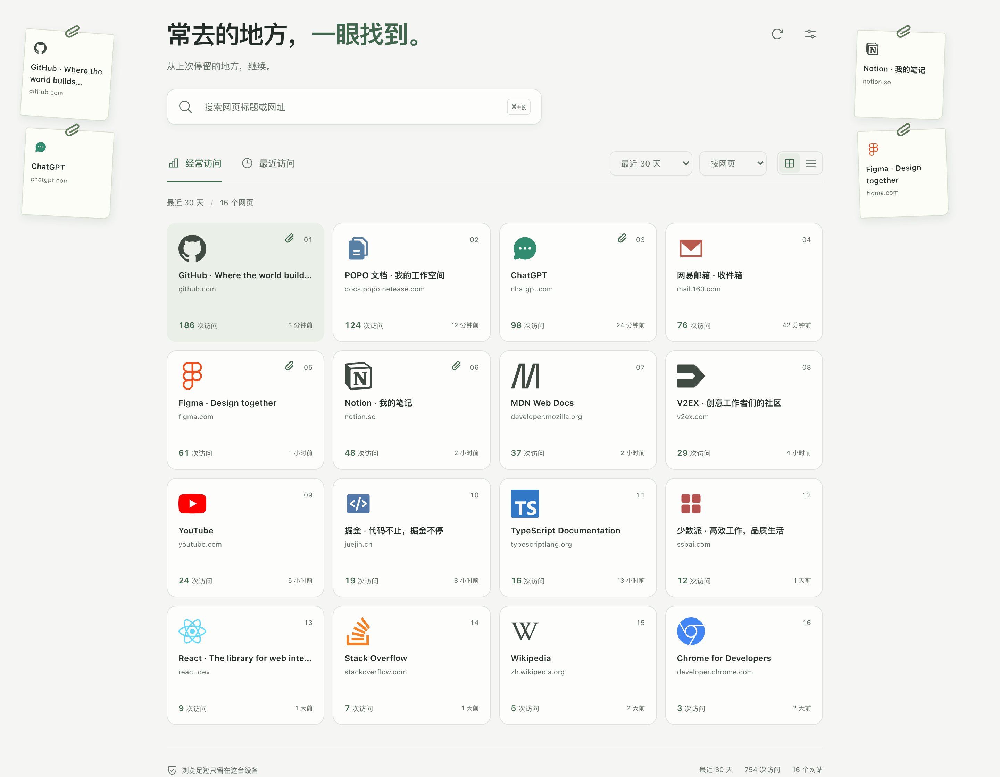
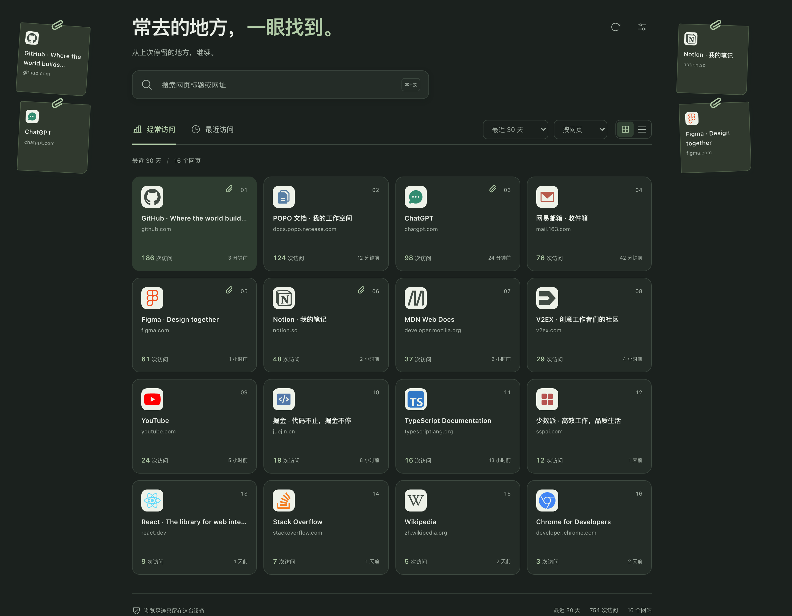

# TabPerch

把 Chrome 新标签页换成一张「常去的地方」的桌面：常用网页按访问次数排成卡片，还想再看一眼的网页随手挂到两侧，下次打开还在。

<p align="center">
  
</p>

<p align="center">
  <a href="https://github.com/MonaLisaFineHair/TabPerch/releases/latest"></a>
  
  
  
  <a href="./LICENSE"></a>
</p>

<p align="center">
  
</p>

## 为什么做这个

浏览器的新标签页要么空着，要么塞满推荐内容。可真正每天要打开的就那么十几个页面，并且总有几个是「等会儿再看」的——它们在标签栏里挤成一排，关掉就再也找不回来。

TabPerch 把这些事放进同一屏：左侧按访问次数排出你真正常用的入口，右侧像便签墙一样挂住待看的网页。所有数据留在本机，没有账号、没有服务器、没有遥测。

## 特性

- **访问排行**：读取 `chrome.history` 的访问事件，按次数降序排列，同次数按最近访问时间；可切换最近访问排序。时间范围支持今天 / 3 天 / 7 天 / 30 天 / 全部。
- **拖到两侧暂存**：把卡片拖到左右空白区，变成一张带夹子、自然倾斜的纸签；也可点卡片上的回形针按钮或聚焦后回车。拖回主区域即可取消，可撤销。
- **暂存独立于历史**：暂存按网页单独存储，不受时间范围、搜索、隐藏设置影响，换个新标签页仍然在，也不会随历史记录被清理。
- **按网页 / 按网站分组**：自动合并仅追踪参数（`utm_*`、`gclid`、`fbclid`）不同的地址，保留业务查询参数与 `#/`、`#!` 路由；按网站时合并同主机同端口。
- **轻量预览**：点击卡片展开就地浮层，显示完整标题、域名与可展开的网址。可选开启本机页面快照，或按需加载在线预览。
- **纯本地且有边界**：默认只申请 `history`、`storage`、`favicon`；页面快照需要用户主动同意可选网站权限，且只缓存当前聚焦正常窗口里已加载完成的可见区域。
- **细节**：网格 / 列表视图、系统 / 浅色 / 深色主题、24 / 48 / 96 个入口上限、`⌘K` / `Ctrl+K` 搜索、隐藏与撤销、窄窗口下暂存区自动移到主区域下方。

<details>
<summary>展开完整行为说明</summary>

- 默认统计今天（浏览器本地时间零点至现在）；最近 N 天为滚动的 N × 24 小时。首次更新至 1.1.0 时切换为今天，之后记住所选范围。
- favicon 使用 Chrome 本地接口，统一 40px；主区域卡片等尺寸，用名次、次数和首位浅色强调体现常用程度。
- 暂存纸签可拖动调整位置或换边；两侧空间不足时自动分列、缩放，不用内部滚动条，很密集时以图标为主，悬停可看完整标题与网址。
- 空间足够时保留手动落点；拥挤或改变窗口大小后自动整理，旧版本暂存记录也会纳入排布。
- 搜索匹配标题与网址，`Esc` 清空，`Enter` 预览第一个结果；普通点击走浮层预览，`Ctrl` / `Cmd` 点击、中键、右键菜单保留直接打开。
- 页面快照默认关闭，启用后仅在已加载完成的 HTTP / HTTPS 页面可见区域截图，不记录隐身窗口、浏览器内部页面或隐藏标签页；图片最长边 1200px、JPEG 压缩、最多 20 张 / 10MB / 7 天，存于本机 IndexedDB。
- 统计结果缓存在 `chrome.storage.session` 最多 5 分钟，历史变化时失效；设置、隐藏键与暂存纸签存于 `chrome.storage.local`。
- 历史搜索每批读取 2,000 条并分页，最多扫描约 50,000 个网页，达到上限或分页异常时页面会明确提示统计不完整。

</details>

## 安装

### 从 Release 安装（推荐）

1. 到 [Releases](https://github.com/MonaLisaFineHair/TabPerch/releases/latest) 下载最新的 `TabPerch-v*.zip` 并解压。
2. 打开 `chrome://extensions`，开启右上角「开发者模式」。
3. 点「加载已解压的扩展程序」，选择解压出来的目录。
4. 点标签栏的加号打开新标签页；Chrome 询问是否保留新标签页修改时选择保留。

### 从源码构建

```bash
git clone https://github.com/MonaLisaFineHair/TabPerch.git
cd TabPerch
npm install
npm run build
```

然后把仓库里的 `dist` 目录加载为扩展。修改源码后重新 `npm run build`，在扩展管理页点刷新，再重新打开新标签页。

## 开发

需要 Node.js 22.12+ 或 24+。

```bash
npm run dev            # 本地开发预览（示例数据）
npm test               # 纯逻辑单元测试
npm run build          # 构建到 dist/
npx playwright install chromium
npm run test:browser   # 真实 MV3 扩展 + 浏览器端验证
npm run audit          # Lighthouse 性能 / 可访问性 / 最佳实践
npm run screenshot     # 重新生成 docs/ 下的 README 截图
```

`npm run dev` 和直接打开构建页面时使用明确标注的示例数据；真实 Chrome 历史只有在扩展环境下才能读取。示例图标来自 [Simple Icons](https://simpleicons.org/) 与 [Phosphor](https://phosphoricons.com/)，随扩展一起打包，运行时不请求外部图标服务。`scripts/create-assets.mjs` 用于重新生成扩展图标与预览图标。

浏览器端验证覆盖搜索、分组、时间范围、排序、隐藏与撤销、等尺寸卡片、拖放暂存、调整位置、换边、取消与撤销、跨页同步、持久化、主题与移动尺寸，以及实际 Manifest V3 扩展加载、历史读取、新标签页覆盖和历史删除后的暂存保留。

### 项目结构

```
src/
  App.jsx              页面结构与交互状态
  PagePreview.jsx      卡片就地预览浮层
  PreviewBoundary.jsx  隔离框架的错误边界
  HangingZone.jsx      两侧暂存区与拖放
  SnapshotSettings.jsx 页面快照授权与缓存管理
  history.js           历史读取、分组、排序与偏好存储
  parking.js           暂存纸签的读写与规范化
  hanging-layout.js    纸签自动分列与缩放
  snapshot-preview.js  快照抓取、压缩与 IndexedDB 缓存
  preview.js           非扩展环境下的示例数据
public/                manifest、background service worker、图标
scripts/               资源生成、浏览器验证、Lighthouse、截图
tests/                 历史分组与暂存逻辑的单元测试
```

## 隐私

- 基础权限仅 `history`、`storage`、`favicon`。页面快照额外使用可选的 `<all_urls>`，只在用户主动启用时请求，用于调用 Chrome 的可见页面截图接口，随时可在设置中暂停或清空缓存。
- 浏览记录、图标、设置与图片全部在本机处理，没有服务器、没有遥测、没有远程字体或第三方图标服务。
- 快照预览不请求网站；只有手动切到「在线预览」时才加载所选网站，且不向网站提供完整历史或暂存列表。外部网页在隔离框架中展示，不能替换本页或打开弹窗。
- 访问次数来自 `chrome.history.getVisits`，只统计所选区间内的顶层网页访问，不使用累计 `visitCount`，排除内嵌框架访问，避免预览本身抬高排名。
- 卸载扩展会移除扩展存储。隐藏入口不会删除浏览器历史；Chrome 已删除或过期、隐身访问的历史都无法恢复。

## 贡献

Issues 与 Pull Request 都欢迎。提 PR 前请确认：

```bash
npm test && npm run build
```

涉及界面或交互的改动，最好附上 `npm run test:browser` 通过的结果或截图说明。

## 致谢

布局设计参考 [zarazhangrui/tab-out](https://github.com/zarazhangrui/tab-out)。本项目是独立实现——这里展示浏览历史，参考项目展示当前打开的标签页。

## License

[MIT](./LICENSE)
